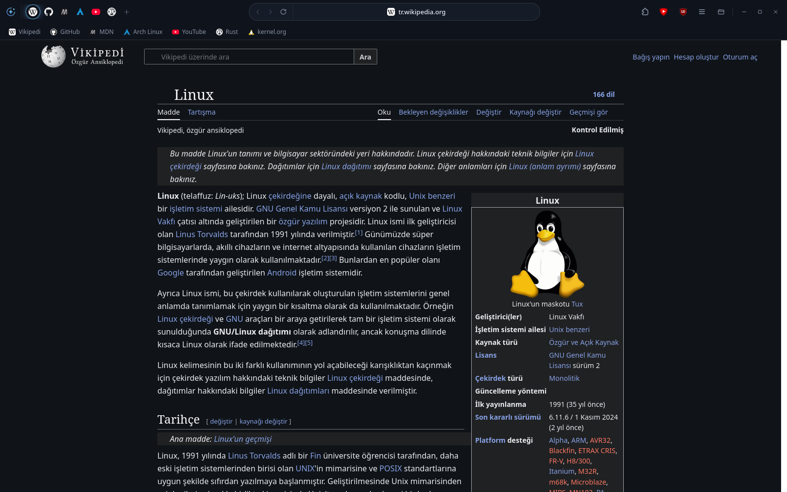
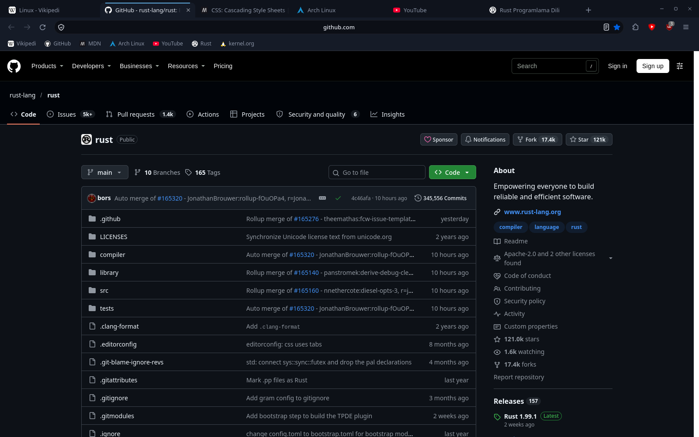
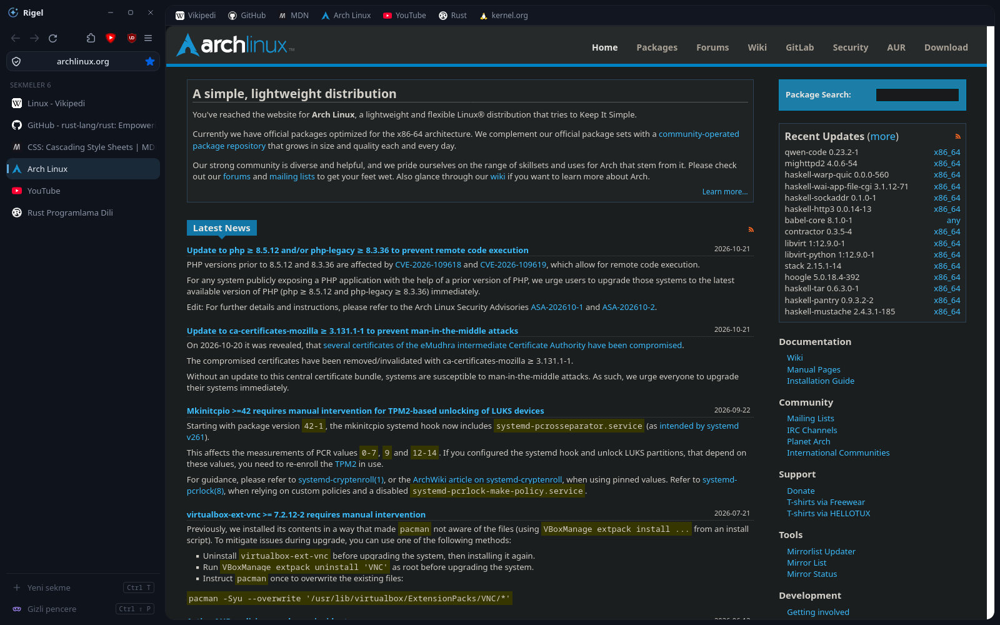
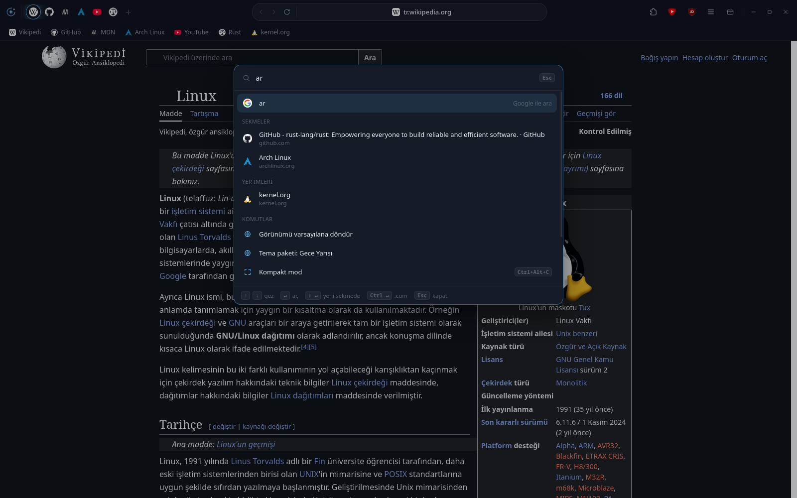
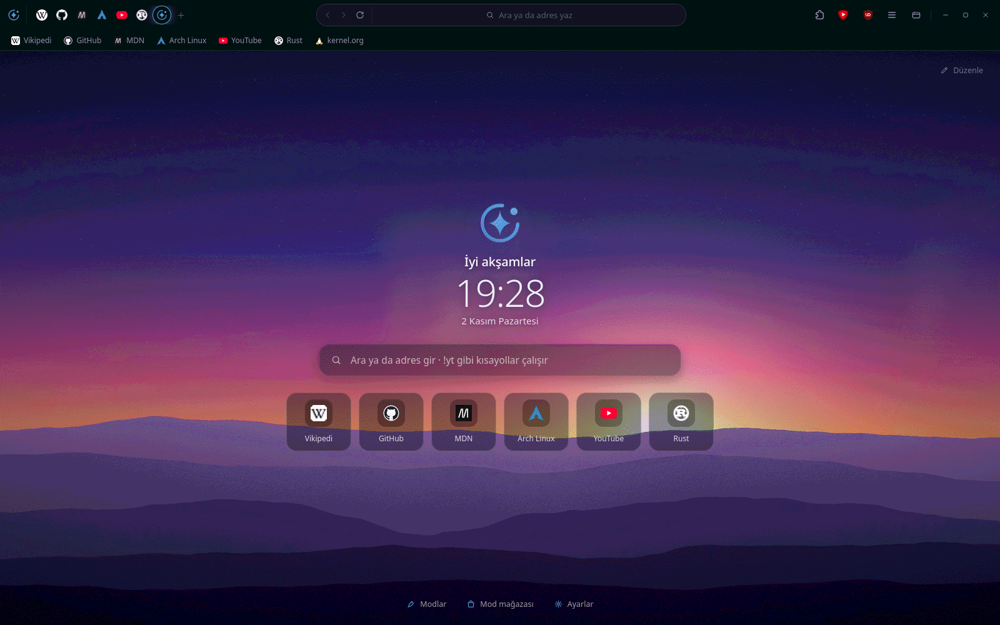
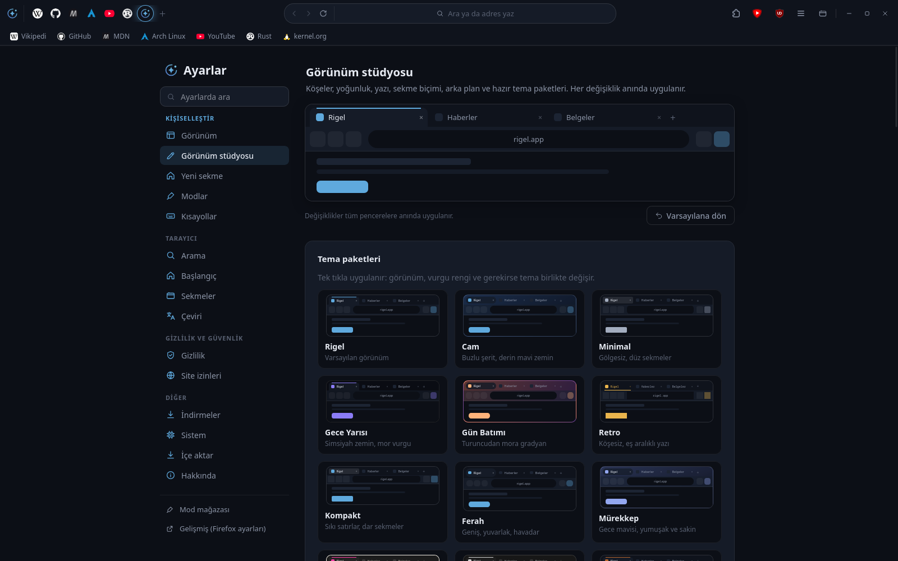
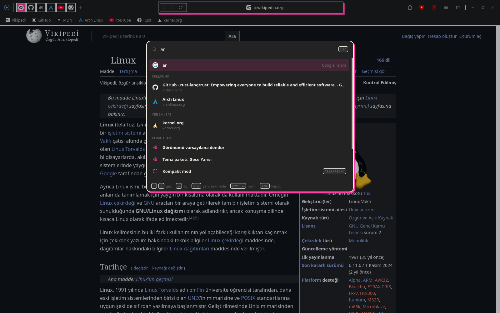
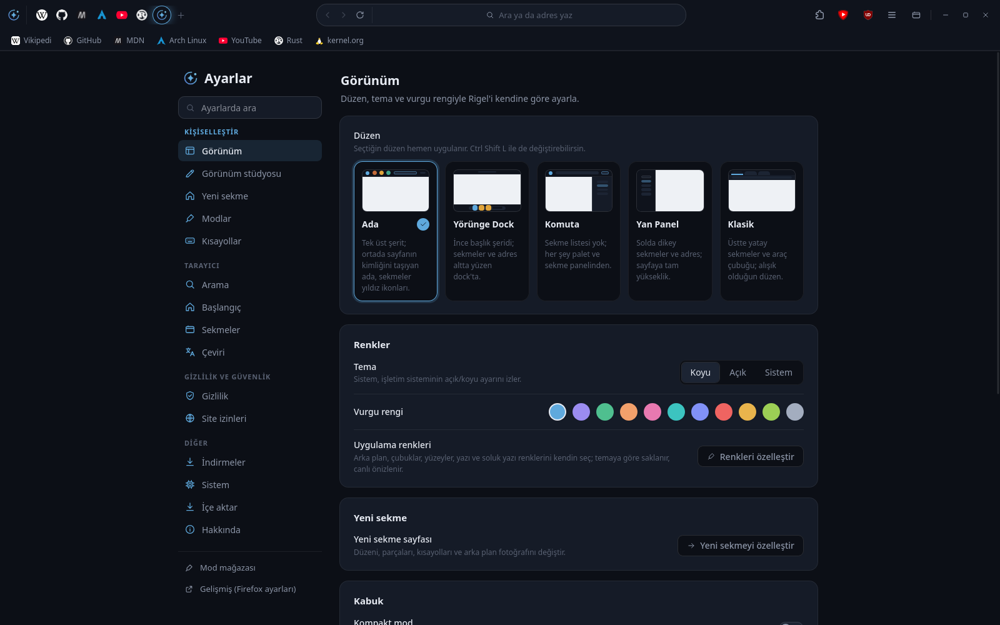
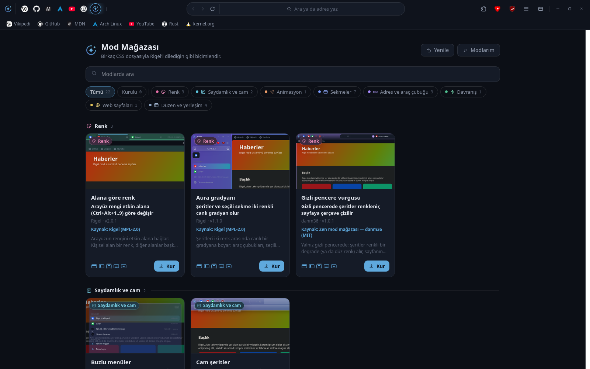

# Rigel

Firefox (Gecko) tabanlı, [Zen Browser](https://zen-browser.app/)'dan esinlenen kişisel web tarayıcısı.
Derleme yok: Mozilla'nın resmî Firefox ikilisi, [fx-autoconfig](https://github.com/MrOtherGuy/fx-autoconfig) ve Rigel'in kendi arayüz kodu (`src/rigel/`) bir araya gelir.
Tüm Firefox özellikleri (kodekler, uzantılar, PiP) olduğu gibi çalışır.

<p align="center">
  
</p>

## Özellikler

- **Beş düzen:** Ada, Yörünge Dock, Komuta, Yan Panel, Klasik. `Ctrl+Shift+L` ile yeniden başlatmadan değişir.
- **Palet (`Ctrl+K`):** adres, arama, açık sekmeler, geçmiş/yer imi, 65 komut ve `!bang` kısayolları.
- **Zen özellikleri:** Glance (Alt+tık), kompakt mod, alanlar (`Ctrl+Alt+1..9`), Essentials, sekme grupları, kapsayıcılar.
- **Modlar ve mağaza:** CSS modları (arayüz ve web), 19 yerleşik mod, güvenlik denetimli kurulum.
- **Tema:** koyu/açık/sistem, 5 vurgu rengi; Rigel gizli pencere görünümü; hareket ve animasyonlar.
- **Kitaplık, ayarlar, ilk açılış sihirbazı**, Türkçe ek çekimleri ("Rigel'i", "Rigel'e"), Rigel yeni sekme sayfası.
- **Gizlilik:** telemetri, çalışmalar, Pocket, sponsorlu öneriler ve Firefox hesabı kapalı. uBlock Origin, SponsorBlock ve Dark Reader ilk açılışta kurulur (kaldırılabilir, geri gelmez).

Ayrıntılı durum ve bilinen eksikler: [docs/DURUM.md](docs/DURUM.md). Plan: [docs/PLAN.md](docs/PLAN.md).

## Ekran görüntüleri

<p align="center">
  <br>
  <sub><b>Ada</b> Tek üst şerit: sekmeler küçük ikonlar olarak durur, adres ortadaki adada yer alır; sayfa ekranı doldurur.</sub>
</p>

<table>
  <tr>
    <td width="50%" valign="top">
      <br>
      <sub><b>Klasik</b> Üstte yatay sekmeler, adres çubuğu ve yer imleri; alışık olduğun düzen.</sub>
    </td>
    <td width="50%" valign="top">
      <br>
      <sub><b>Yan Panel</b> Solda dikey sekmeler ve adres; sayfa tam yükseklikte.</sub>
    </td>
  </tr>
  <tr>
    <td width="50%" valign="top">
      <br>
      <sub><b>Palet (Ctrl+K)</b> Açık sekmeler, yer imleri, geçmiş ve komutlar tek kutuda.</sub>
    </td>
    <td width="50%" valign="top">
      <br>
      <sub><b>Yeni sekme</b> Fotoğraf arka planı, saat, karşılama ve kısayollar.</sub>
    </td>
  </tr>
  <tr>
    <td width="50%" valign="top">
      <br>
      <sub><b>Görünüm stüdyosu</b> Köşe, yoğunluk, yazı, arka plan ve hazır tema paketleri; anında uygulanır.</sub>
    </td>
    <td width="50%" valign="top">
      <br>
      <sub><b>Brütal teması</b> Kalın çizgi ve sert gölge; koyu ve açık için ayrı renkler.</sub>
    </td>
  </tr>
  <tr>
    <td width="50%" valign="top">
      <br>
      <sub><b>Ayarlar</b> Düzen, tema ve vurgu rengi tek yerden seçilir.</sub>
    </td>
    <td width="50%" valign="top">
      <br>
      <sub><b>Mod mağazası</b> CSS modlarıyla arayüzü ve web sayfalarını biçimlendir.</sub>
    </td>
  </tr>
</table>

<sub>Görüntüler Rigel'in koyu temasında, 1600x1000 pencerede alınmıştır.</sub>

## Kurulum

### Hızlı kurulum

**Linux (x86_64):** son sürümü indirir, SHA256 ile doğrular ve kurar. Tekrar çalıştırmak günceller.

```bash
curl -fsSL https://raw.githubusercontent.com/oktayyavuz/rigeldesktop/main/kur.sh | bash
```

**Windows (x64, PowerShell):** son sürümün kurulum programını indirir, doğrular ve kurar (yönetici gerekmez).

```powershell
irm https://raw.githubusercontent.com/oktayyavuz/rigeldesktop/main/kur.ps1 | iex
```

**Arch Linux:** AUR paketi henüz yayımlanmadı. O zamana dek depodaki PKGBUILD ile derlenebilir (Rigel sürüm etiketini ve Mozilla'nın Firefox arşivini indirir):

```bash
git clone https://github.com/oktayyavuz/rigeldesktop && cd rigeldesktop/packaging/aur && makepkg -si
```

Hazır dosyalar (tar.xz, AppImage, Windows kurulum programı ve zip) [Sürümler](https://github.com/oktayyavuz/rigeldesktop/releases/latest) sayfasında.

### Kaynaktan kurulum

### Linux (x86_64)

```bash
git clone https://github.com/oktayyavuz/rigeldesktop
cd rigeldesktop
./install.sh
```

Root gerekmez. `install.sh` şunları yapar:

1. `FIREFOX_VERSION` dosyasındaki Firefox sürümünü (Türkçe, x86_64) `archive.mozilla.org`'dan indirir ve **SHA256'sını Mozilla'nın `SHA256SUMS` dosyasıyla doğrular** (uyuşmazsa kurulum durur). İndirme `~/.cache/rigel/` altında önbelleğe alınır.
2. Her şeyi `~/.local/share/rigel/` altına kurar: `app/` (Firefox + Rigel katmanı), `rigel/`, `utils/` (fx-autoconfig), `profile/` (ilk açılışta oluşur), `VERSION`.
3. `~/.local/bin/rigel` başlatıcısını, `rigel.desktop` girdisini ve ikonları yazar.

Varsayılan tarayıcı **değiştirilmez**. İsterseniz: `xdg-settings set default-web-browser rigel.desktop`.

Gereksinimler: `curl` (ya da `wget`), `tar`, `xz`, `sha256sum`; videolar için sistemde `ffmpeg`. Seçenekler: `./install.sh --yardim`.

| Seçenek | Açıklama |
|---|---|
| `--guncelle` | Yalnız Rigel dosyalarını yeniler; `FIREFOX_VERSION` değişmediyse Firefox'a dokunmaz |
| `--profil-tasi <dizin>` | Var olan bir profili (ör. geliştirme profili `proto/profile`) boş Rigel profiline kopyalar; kaynak profil değişmez, Rigel kapalı olmalı |
| `RIGEL_HOME=…` | Kurulum klasörünü değiştirir (varsayılan `~/.local/share/rigel`) |

Başlatıcı (`rigel`) profilin `chrome/utils` ve `chrome/JS` klasörlerini kuruluma bağlar, Rigel dosyaları değiştiyse Firefox'un başlangıç önbelleğini temizler. `rigel https://…` ile verilen adresler, Rigel açıksa çalışan pencerede açılır.

### Arch Linux (PKGBUILD)

```bash
git clone https://github.com/oktayyavuz/rigeldesktop
cd rigeldesktop/packaging/arch
makepkg -si
```

`rigel-browser` paketi `/opt/rigel` altına kurulur, `/usr/bin/rigel` komutunu verir; profil yine kullanıcı başına `~/.local/share/rigel/profile` olur. Firefox arşivi sha256 ile sabitlenmiştir. `FIREFOX_VERSION` değişirse PKGBUILD'deki `_ffver` ve `sha256sums` da güncellenmelidir (aksi halde `prepare()` hata verir).

### Windows (deneysel, test edilmedi)

> **Uyarı:** Windows betikleri bu depoda yazıldı ama bir Windows makinede **hiç çalıştırılmadı**. Sorun çıkabilir.

PowerShell'de, klonlanmış depoda:

```powershell
powershell -ExecutionPolicy Bypass -File packaging\windows\install.ps1
```

Mozilla'nın Firefox yükleyicisini indirir, SHA256'sını doğrular, `%LOCALAPPDATA%\Rigel\app` altına sessizce kurar (kısayol, bakım hizmeti ve varsayılan tarayıcı aracısı olmadan), Rigel dosyalarını ve profili yerleştirir, Başlat menüsü ve masaüstü kısayolu oluşturur. `chrome\JS` ve `chrome\utils` için dizin bağlantısı (junction) kullanılır; olmazsa kopyalanır. Bilinen sınırlama: görev çubuğu simgesi Firefox simgesi olarak görünebilir.

## Derleme

Rigel'de Firefox derlenmez; "derleme", Mozilla'nın resmî Firefox ikililerini Rigel dosyalarıyla paketlemektir. Tek komut:

```bash
scripts/build.sh [linux|windows|all]     # varsayılan: all; çıktılar dist/ altına (git'e girmez)
```

| Çıktı (`dist/`) | İçerik |
|---|---|
| `rigel-<sürüm>-linux-x86_64.tar.xz` | Kendi içinde tam klasör: Firefox + fx-autoconfig + Rigel, `bin/rigel` başlatıcısı, `rigel.desktop`, ikonlar, `install.sh`, `uninstall.sh` |
| `rigel-<sürüm>-x86_64.AppImage` | İsteğe bağlı; `appimagetool` varsa ya da `RIGEL_APPIMAGE=1` ile (aşağıya bakın) |
| `rigel-<sürüm>-windows-x64.zip` | Taşınabilir Windows sürümü (`Rigel.cmd` ile başlar) |
| `rigel-<sürüm>-windows-x64-setup.exe` | Windows kurulum programı (Inno Setup; kullanıcı başına, yönetici gerekmez, Başlat menüsü + kaldırıcı, Türkçe/İngilizce) |
| `SHA256SUMS` | Yukarıdakilerin özetleri |

**Gereksinimler:** `bash`, `curl`/`wget`, `tar`, `xz`, `sha256sum`, `python3`. Windows için ek olarak `7z` (p7zip) ve kurulum programı ile Firefox simgesi için `wine` (yoksa yalnız zip üretilir). Betik hiçbir sistem paketi kurmaz.

**Nasıl çalışır:**
- Firefox sürümü `FIREFOX_VERSION` dosyasından gelir; Linux için `linux-x86_64/tr/firefox-<sürüm>.tar.xz`, Windows için `win64/tr/Firefox Setup <sürüm>.exe` `archive.mozilla.org`'dan indirilir ve **Mozilla'nın `SHA256SUMS` dosyasıyla doğrulanır** (uyuşmazsa durur). İndirmeler `~/.cache/rigel-build/` altında önbelleğe alınır (`RIGEL_BUILD_CACHE` ile değişir); geçici çalışma klasörü de orada açılır (`/tmp` RAM'de olabilir).
- Windows ikilisi `7z` ile açılır (uygulama `core/` içindedir). Windows'ta sembolik bağlantı olmadığı için her şey **kopyalanır**: kurulum programı arayüz dosyalarını doğrudan profile (`%LOCALAPPDATA%\Rigel\profile\chrome\{JS,utils}`) yazar; zip'teki `Rigel.cmd` ise sürüm damgası değişince bunları profile kopyalayıp Firefox'u `--profile` ile açar.
- Kurulum programı, resmî Inno Setup 6.7.4'ün (SHA256 sabitli) ayrı bir `WINEPREFIX` içinde (`~/.cache/rigel-build/wine`) wine ile çalıştırılmasıyla derlenir; kullanıcının kendi `~/.wine` öneki kullanılmaz. Görev çubuğu/pencere simgesi için `firefox.exe` içindeki simge, `rcedit` (v2.0.0, SHA256 sabitli) ile Rigel simgesiyle değiştirilir; bu, `firefox.exe`'nin Mozilla imzasını düşürür (`RIGEL_WINDOWS_ICON=0` ile kapatılır).
- Tekrarlanabilirlik: arşivler sıralı, sahipsiz ve `SOURCE_DATE_EPOCH` (varsayılan: HEAD işleminin zamanı) damgalıdır; aynı girdilerle Linux `tar.xz` ve Windows `zip` bit bit aynı çıkar. Windows `setup.exe` (Inno Setup derleme zamanını gömer) ve AppImage aynı olmayabilir.

| Ortam değişkeni | Etki |
|---|---|
| `RIGEL_BUILD_CACHE` | Önbellek ve geçici klasör (varsayılan `~/.cache/rigel-build`) |
| `RIGEL_DIST` | Çıktı klasörü (varsayılan `dist/`) |
| `RIGEL_APPIMAGE=0\|1` | `0`: AppImage'ı atla; `1`: `appimagetool` yoksa 1.9.1'i (SHA256 sabitli) indir. Varsayılan: araç varsa kullan, yoksa atla. `mksquashfs` gerekir |
| `RIGEL_WINDOWS_INSTALLER=0` | Yalnız Windows zip'i |
| `RIGEL_WINDOWS_ICON=0` | `firefox.exe` simgesine dokunma |
| `RIGEL_XZ_LEVEL`, `RIGEL_XZ_THREADS` | `xz` düzeyi (varsayılan 6) ve iş parçacığı |
| `SOURCE_DATE_EPOCH` | Arşiv zaman damgası |

**Kullanıcı olarak kurmak:**
- *Linux tar.xz:* `tar -xf rigel-<sürüm>-linux-x86_64.tar.xz && cd rigel-<sürüm>-linux-x86_64 && ./install.sh` (internet gerekmez; `~/.local/share/rigel`, `~/.local/bin/rigel`, uygulama menüsü girdisi). Kurmadan denemek için `./bin/rigel`. Kaldırmak: `./uninstall.sh [--profil-de]`. Profil her iki durumda da `~/.local/share/rigel/profile` olur (`RIGEL_PROFILE` ile değişir).
- *AppImage:* `chmod +x rigel-<sürüm>-x86_64.AppImage && ./rigel-<sürüm>-x86_64.AppImage` (FUSE yoksa `--appimage-extract-and-run`). Profil yine `~/.local/share/rigel/profile`.
- *Windows setup.exe:* çift tıklayın (imzasız olduğu için SmartScreen uyarısı çıkabilir). `%LOCALAPPDATA%\Programs\Rigel` altına kurar, profil `%LOCALAPPDATA%\Rigel\profile`; "Varsayılan uygulamalar" listesine Rigel'i ekler (varsayılanı kendiliğinden değiştirmez). Kaldırırken profilin silinip silinmeyeceği sorulur (varsayılan: korunur).
- *Windows zip:* herhangi bir klasöre açıp `Rigel.cmd`'yi çalıştırın; profil `%LOCALAPPDATA%\Rigel\profile`.

**Sürüm yayımlamak:** `VERSION`'ı güncelleyip `v<sürüm>` etiketi itilince `.github/workflows/release.yml` aynı betiği çalıştırıp `dist/*`'ı GitHub Sürümü olarak yükler (henüz hiç çalıştırılmadı).

**Sınırlar:** Windows paketleri Windows'ta çalıştırılarak denenmedi; yalnız wine altında (derleme, sessiz kurulum, Firefox'un başsız açılışında Rigel'in yüklenmesi) doğrulandı. Paketler imzasızdır. Firefox otomatik güncellenmez (`DisableAppUpdate`); yeni Firefox için `FIREFOX_VERSION` değiştirip yeniden derleyin.

## Güncelleme

```bash
cd rigeldesktop && git pull
./install.sh --guncelle        # Arch: makepkg -si   |   Windows: install.ps1'i yeniden çalıştırın
```

Firefox sürümü yalnızca `FIREFOX_VERSION` değişince güncellenir: Rigel kurulu Firefox'u kendi başına güncellemez (`DisableAppUpdate` ilkesi açık). Böylece Firefox ve Rigel arayüzü kodu hep birlikte, test edilmiş sürümle gelir. Güvenlik güncellemeleri için depoyu düzenli çekin.

## Kaldırma

```bash
./uninstall.sh                 # uygulamayı kaldırır, profili (yer imleri, geçmiş, ayarlar) korur
./uninstall.sh --profil-de     # profili de siler (onay ister; --evet soru sormaz)
```

Arch: `sudo pacman -R rigel-browser`. Windows: `packaging\windows\uninstall.ps1 [-ProfilDe]`.

## Geliştirme

```bash
proto/setup.sh   # bir kez: Firefox'u proto/firefox altına indirir; fx-autoconfig'i (vendor/) ve profili kurar
proto/run.sh     # Rigel'i proto/profile ile açar (önbelleği temizler); chrome/JS → src/rigel
packaging/linux/install-dev.sh   # bir kez: görev çubuğu logosu için rigel.desktop (proto/run.sh'yi gösterir)
```

- Giriş noktası: `src/rigel/rigel.uc.mjs`. Hata ayıklama: Browser Toolbox (`Ctrl+Alt+Shift+I`).
- Varsayılan tercihler: `prefs/rigel.js` → Firefox'un `browser/defaults/preferences/` klasörü (kullanıcı ayarları kalıcı kalır; `user.js` kullanılmaz).
- İlkeler: `distribution/policies.json`. Not: `/etc/firefox/policies/policies.json` varsa bu dosya yok sayılır.
- Testler:

```bash
node --test 'src/rigel/search/tests/*.test.mjs' 'src/rigel/l10n/tests/*.test.mjs'
```

Depo düzeni: `src/rigel/` (arayüz), `vendor/fx-autoconfig/` (MPL-2.0), `prefs/`, `distribution/`, `packaging/{linux,arch,windows}/`, `design/` (logo), `docs/`.

## Lisans

- Rigel kodu: **MPL-2.0** ([LICENSE](LICENSE)).
- **Firefox** kurulum sırasında Mozilla'dan indirilir; bu depoda dağıtılmaz. Firefox, Mozilla Foundation'ın tescilli markasıdır; Rigel Mozilla ile bağlantılı değildir ve onaylanmamıştır. Firefox kendi lisansına (MPL-2.0 ve diğerleri) tabidir.
- **fx-autoconfig** ([MrOtherGuy](https://github.com/MrOtherGuy/fx-autoconfig)): MPL-2.0, `vendor/fx-autoconfig/LICENSE`.
- Mod mağazasındaki 9 mod, [Zen theme-store](https://github.com/zen-browser/theme-store)'daki MIT lisanslı modların uyarlamasıdır; telif ve atıf notları ilgili mod dosyalarının başında korunur (bkz. `src/rigel/mods/STORE.md`).
