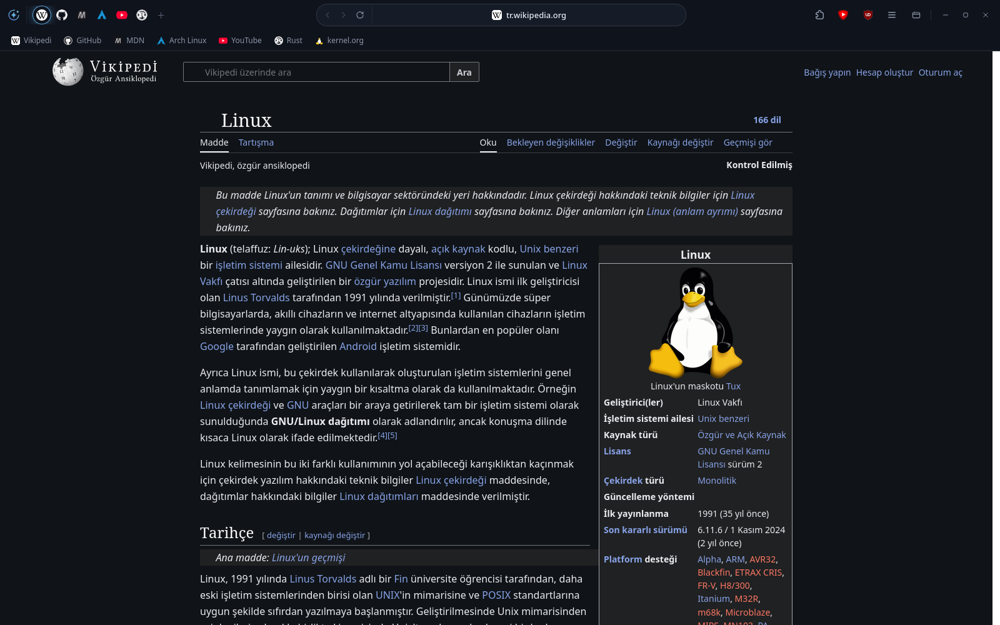
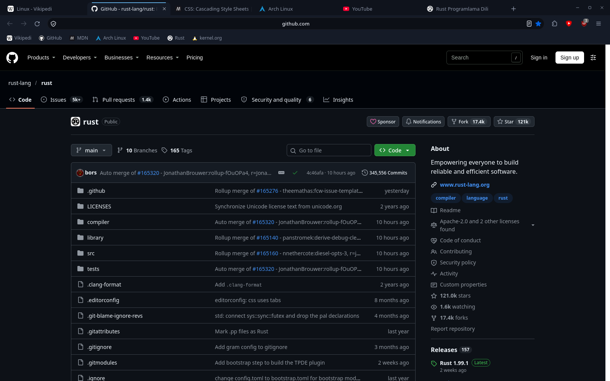
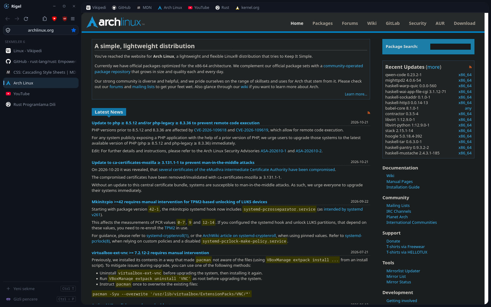
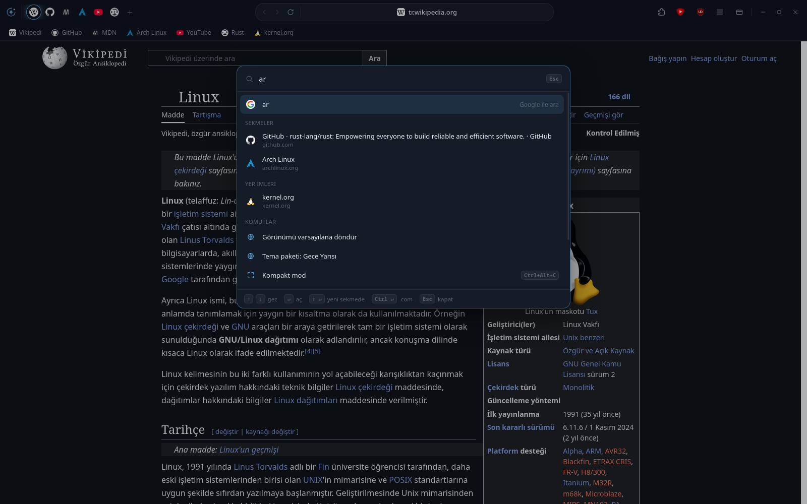
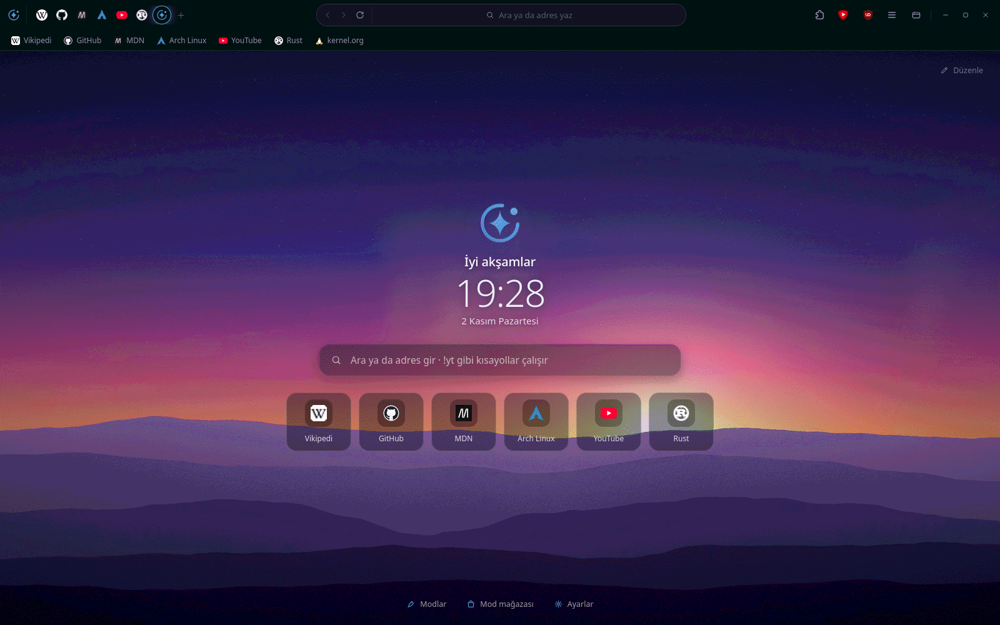
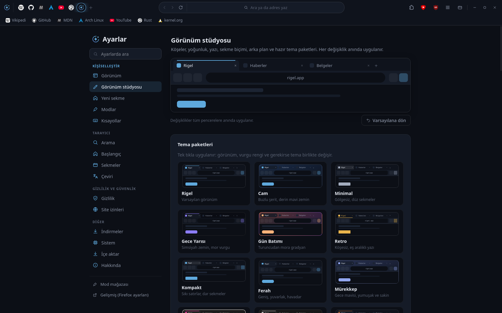
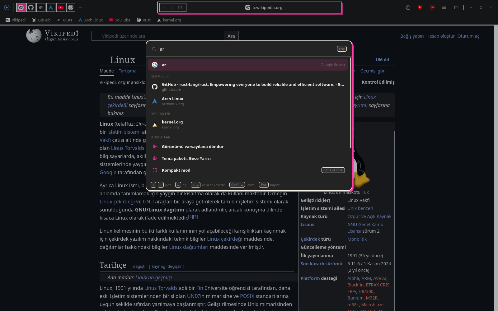
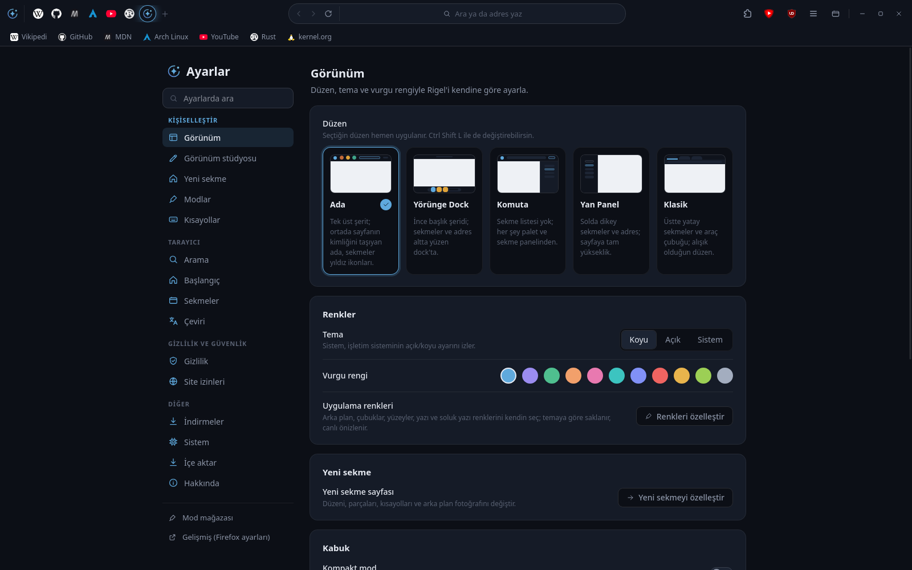
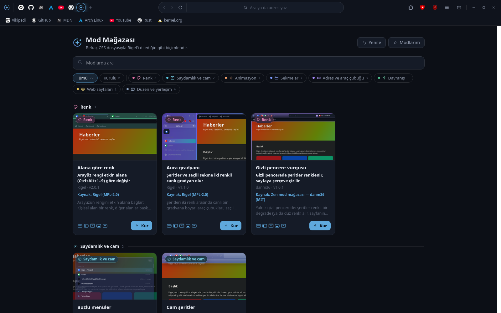

# Rigel

[English](README.md) · **Türkçe**

Firefox (Gecko) tabanlı, [Zen Browser](https://zen-browser.app/)'dan esinlenen kişisel bir web tarayıcısı.
Rigel Firefox'u derlemez: Mozilla'nın resmî Firefox'unu, [fx-autoconfig](https://github.com/MrOtherGuy/fx-autoconfig)'i ve kendi arayüz kodunu (`src/rigel/`) bir araya getirir.
Firefox'un yaptığı her şey (kodekler, eklentiler, resim içinde resim) olduğu gibi çalışır.

<p align="center">
  
</p>

## Özellikler

- **Beş düzen:** Ada, Yörünge Dock, Komuta, Yan Panel ve Klasik. `Ctrl+Shift+L` ile yeniden başlatmadan değişir.
- **Palet (`Ctrl+K`):** adres, arama, açık sekmeler, geçmiş ve yer imleri, 65 komut ve `!bang` kısayolları (`!yt`, `!w`, `!gh`…).
- **Zen özellikleri:** Glance (Alt+tık), kompakt mod, alanlar (`Ctrl+Alt+1..9`), Essentials, sekme grupları, kapsayıcılar.
- **Görünüm stüdyosu:** köşeler, yoğunluk, yazı tipi, cam, gölge, çerçeve, sekme biçimi, araç düğmeleri, görsel ya da gradyan arka plan, her yüzey için özel renkler ve kaydedip paylaşabileceğin tema paketleri.
- **Özelleştirilebilir yeni sekme:** düzenleme modu, parçaları açıp kapatma, kendi kısayolların, farklı düzenler ve fotoğraf arka planı.
- **Modlar ve mağaza:** tarayıcı ve web siteleri için CSS modları; ayarlar, düzene özel destek ve çakışma uyarıları.
- **Oturum geri yükleme:** yeni sekmeyle başlasan bile önceki oturum bir tık uzakta.
- **Gizlilik:** telemetri, çalışmalar, Pocket, sponsorlu öneriler ve Firefox hesabı kapalı. uBlock Origin, SponsorBlock ve Dark Reader ilk açılışta kurulur (kaldırılabilir).

## Ekran görüntüleri

<table>
  <tr>
    <td width="50%" valign="top">
      <br>
      <sub><b>Klasik</b> Üstte yatay sekmeler, adres çubuğu ve yer imleri; alışık olduğun düzen.</sub>
    </td>
    <td width="50%" valign="top">
      <br>
      <sub><b>Yan Panel</b> Solda dikey sekmeler ve adres; sayfa tam yükseklikte.</sub>
    </td>
  </tr>
  <tr>
    <td width="50%" valign="top">
      <br>
      <sub><b>Palet (Ctrl+K)</b> Açık sekmeler, yer imleri, geçmiş ve komutlar tek kutuda.</sub>
    </td>
    <td width="50%" valign="top">
      <br>
      <sub><b>Yeni sekme</b> Fotoğraf arka planı, saat, karşılama ve kısayollar.</sub>
    </td>
  </tr>
  <tr>
    <td width="50%" valign="top">
      <br>
      <sub><b>Görünüm stüdyosu</b> Köşe, yoğunluk, yazı, arka plan ve hazır tema paketleri; anında uygulanır.</sub>
    </td>
    <td width="50%" valign="top">
      <br>
      <sub><b>Brütal teması</b> Kalın çizgi ve sert gölge; koyu ve açık için ayrı renkler.</sub>
    </td>
  </tr>
  <tr>
    <td width="50%" valign="top">
      <br>
      <sub><b>Ayarlar</b> Düzen, tema ve vurgu rengi tek yerden seçilir.</sub>
    </td>
    <td width="50%" valign="top">
      <br>
      <sub><b>Mod mağazası</b> CSS modlarıyla arayüzü ve web sayfalarını biçimlendir.</sub>
    </td>
  </tr>
</table>

## Kurulum

### Hızlı kurulum

**Linux (x86_64):** son sürümü indirir, SHA256 ile doğrular ve kurar. Tekrar çalıştırmak günceller.

```bash
curl -fsSL https://raw.githubusercontent.com/oktayyavuz/rigeldesktop/main/kur.sh | bash
```

**Windows (x64, PowerShell):** son kurulum programını indirir, doğrular ve çalıştırır. Yönetici izni gerekmez.

```powershell
irm https://raw.githubusercontent.com/oktayyavuz/rigeldesktop/main/kur.ps1 | iex
```

**Arch Linux:** AUR paketi henüz yayımlanmadı. O zamana kadar depodaki PKGBUILD ile derleyebilirsin:

```bash
git clone https://github.com/oktayyavuz/rigeldesktop && cd rigeldesktop/packaging/aur && makepkg -si
```

Hazır dosyalar (tar.xz, AppImage, Windows kurulum programı ve zip) [Sürümler](https://github.com/oktayyavuz/rigeldesktop/releases/latest) sayfasında.

| Dosya | Kullanım |
|---|---|
| `rigel-<sürüm>-linux-x86_64.tar.xz` | Aç ve `./install.sh` çalıştır (internet gerekmez). Kurmadan denemek için `./bin/rigel`. |
| `rigel-<sürüm>-x86_64.AppImage` | `chmod +x` yap ve çalıştır. |
| `rigel-<sürüm>-windows-x64-setup.exe` | Çift tıkla; kullanıcı başına kurar. Kurulum programı imzasız olduğu için SmartScreen uyarı verebilir. |
| `rigel-<sürüm>-windows-x64.zip` | Taşınabilir: istediğin yere aç, `Rigel.cmd` ile başlat. |

Profil Linux'ta `~/.local/share/rigel/profile`, Windows'ta `%LOCALAPPDATA%\Rigel\profile` klasöründe durur. Güncelleme ve kaldırma profile dokunmaz.

### Kaynaktan kurulum (Linux)

```bash
git clone https://github.com/oktayyavuz/rigeldesktop
cd rigeldesktop
./install.sh
```

Root gerekmez. `install.sh`, sabitlenmiş Firefox sürümünü (`FIREFOX_VERSION`, Türkçe, x86_64) `archive.mozilla.org`'dan indirir, Mozilla'nın `SHA256SUMS` dosyasıyla doğrular, her şeyi `~/.local/share/rigel/` altına kurar, `rigel` başlatıcısını ve masaüstü girdisini ekler. Varsayılan tarayıcını değiştirmez; istersen: `xdg-settings set default-web-browser rigel.desktop`.

- Güncelleme: `git pull && ./install.sh --guncelle`
- Kaldırma: `./uninstall.sh` (profili korur) ya da `./uninstall.sh --profil-de` (profili de siler)
- Kaynaktan Arch paketi: `cd packaging/arch && makepkg -si` (`/opt/rigel` altına kurar, komut `rigel`)

Gereksinimler: `curl` ya da `wget`, `tar`, `xz`, `sha256sum`; videolar için `ffmpeg`.

## Sürüm dosyalarını derleme

Rigel Firefox'u derlemez; "derleme", Mozilla'nın resmî Firefox'unu Rigel ile paketlemektir:

```bash
scripts/build.sh [linux|windows|all]    # çıktılar dist/ altına
```

Gereksinimler: `bash`, `curl`/`wget`, `tar`, `xz`, `sha256sum`, `python3`; Windows için ayrıca `7z`, kurulum programı için `wine` (yoksa yalnız zip üretilir). İndirmeler Mozilla'nın `SHA256SUMS` dosyasıyla doğrulanır ve `~/.cache/rigel-build` altında saklanır. AppImage için `RIGEL_APPIMAGE=1`.

## Geliştirme

```bash
proto/setup.sh   # bir kez: Firefox'u proto/firefox altına indirir, geliştirme profilini kurar
proto/run.sh     # Rigel'i proto/profile ile açar (başlangıç önbelleğini temizler)
node --test 'src/rigel/search/tests/*.test.mjs' 'src/rigel/l10n/tests/*.test.mjs'
```

Giriş noktası `src/rigel/rigel.uc.mjs`. Varsayılan tercihler `prefs/rigel.js`, ilkeler `distribution/policies.json` içinde. Hata ayıklamak için Browser Toolbox (`Ctrl+Alt+Shift+I`). Mod biçimi `src/rigel/mods/STORE.md` dosyasında.

## Bilinen eksikler

- Bazı Firefox izleri duruyor: sürüm numarası, Hakkında penceresi ve `about:` sayfaları.
- Firefox Sync kapalı.
- Windows sürümü yeni; sorun görürsen bildir.

## Lisans

- Rigel kodu: **MPL-2.0** ([LICENSE](LICENSE)).
- **Firefox** Mozilla'dan indirilir. Firefox, Mozilla Foundation'ın tescilli markasıdır; Rigel'in Mozilla ile bağlantısı yoktur ve Mozilla tarafından onaylanmamıştır.
- **fx-autoconfig** ([MrOtherGuy](https://github.com/MrOtherGuy/fx-autoconfig)): MPL-2.0, `vendor/fx-autoconfig/LICENSE`.
- Mod mağazasındaki 9 mod, [Zen theme store](https://github.com/zen-browser/theme-store)'daki MIT lisanslı modlardan uyarlanmıştır; telif notları mod dosyalarında korunur.
